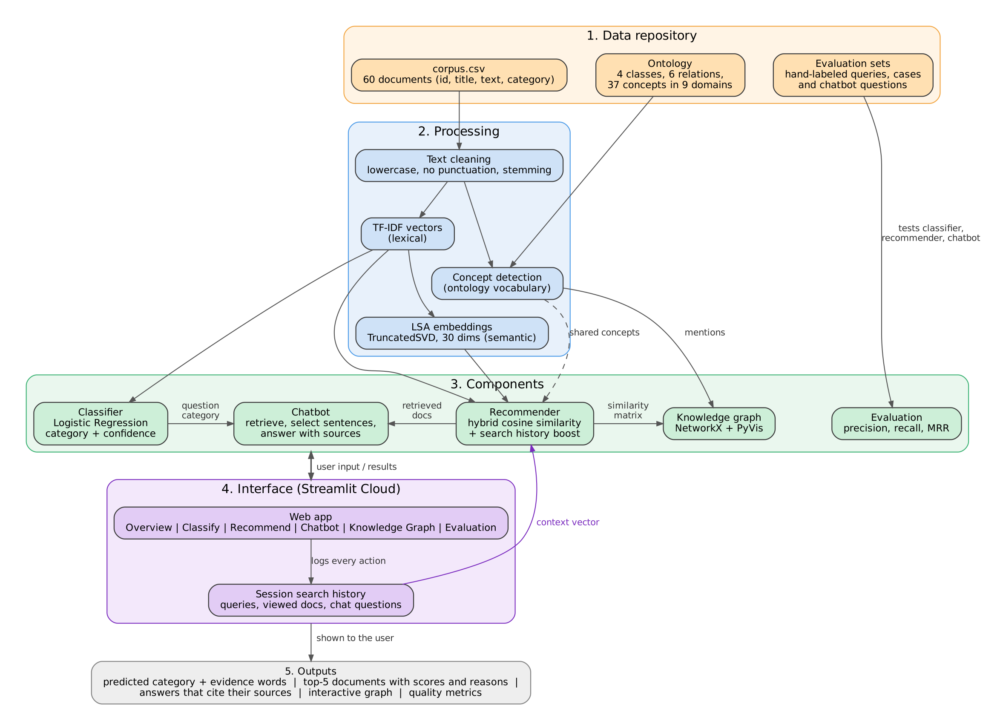

# PolloSoft IT Knowledge Hub

Knowledge management system for PolloSoft's IT area (Phase II, final integrated prototype).
One web app that brings together four components over the same document repository:

| Component | What it does | Technique |
|---|---|---|
| Automated classification | Predicts if a document is a *Policy/Process* or a *Support/Incident* | TF-IDF + Logistic Regression, chosen by 5-fold cross-validation |
| Recommendation system | Suggests related documents for a query or a seed document | Hybrid cosine similarity (LSA embeddings + TF-IDF) + search-history boost |
| Chatbot | Answers natural-language questions from the repository and cites its sources | Retrieval + sentence selection (extractive generation) + out-of-scope check |
| Knowledge graph | Shows documents, concepts, domains and categories and how they relate | Ontology → NetworkX graph → PyVis interactive view |

**Live app:** https://pollosoft-km-system-xyosk8cebnaukd3umk68bu.streamlit.app/



## Repository structure

```
app.py                      Streamlit interface (6 tabs)
requirements.txt            dependencies
data/
  corpus.csv                document repository: 60 docs (id, title, text, category)
  corpus_phase1.csv         original 25-doc corpus from Phase I
  new_documents.py          script that grew the corpus to 60 docs
src/
  text.py                   corpus loading and text cleaning
  ontology.py               classes, relations, 37 concepts in 9 domains, concept detection
  classifier.py             automated document classification
  recommender.py            recommendation system and search history (SearchContext)
  chatbot.py                natural language query component
  knowledge_graph.py        graph construction and PyVis rendering
  evaluation.py             evaluation suite (used by the app and the script)
eval/
  test_queries.csv          25 queries with hand-labeled relevant documents
  recommendation_cases.csv  10 seed documents with expected recommendations
  context_tests.csv         6 ambiguous queries with a previous search
  chatbot_tests.csv         17 chatbot questions (12 in scope, 5 out of scope)
  run_evaluation.py         runs everything and writes eval/results/
  results/                  metrics.json and CSV tables
docs/
  architecture.png / .dot   architecture diagram
  usability.md              usability analysis
  sus_questionnaire.md      SUS survey template
  evidence/                 screenshots of the system running
.streamlit/config.toml      theme
```

## Run it locally

```bash
python -m venv .venv
source .venv/bin/activate          # Windows: .venv\Scripts\activate
pip install -r requirements.txt
streamlit run app.py               # opens http://localhost:8501
```

Run the evaluation from the console:

```bash
python eval/run_evaluation.py
```

## Deploy on Streamlit Community Cloud

1. Push this folder to a **public GitHub repository** (`app.py` must be at the root).
2. Go to https://share.streamlit.io, sign in with GitHub and click **Create app → Deploy a public app from GitHub**.
3. Choose the repository, branch `main` and main file `app.py`, then click **Deploy**.
4. Copy the app link into this README and into the technical document (current deployment: https://pollosoft-km-system-xyosk8cebnaukd3umk68bu.streamlit.app/).

No secrets or API keys are needed: every model is trained from `data/corpus.csv` when the app starts (under a second).

## How to use it

1. **Recommend:** search *my VPN drops when I work from home*, then *connection problem*. With history on, VPN documents come first the second time.
2. **Chatbot:** ask *What should I do if I lose my company phone?*. The answer cites the documents it comes from.
3. **Knowledge Graph:** choose *Focus on a node* → *VPN* to see the documents and concepts around it.
4. **Classify:** paste a new ticket or policy and see its category, confidence and where it would connect in the graph.
5. **Evaluation:** precision, recall and the test cases, computed live.

## Key results

| Metric | Value |
|---|---|
| Classification macro F1 (5-fold CV) | 0.967 (precision 0.969, recall 0.967) |
| Search R@5 / MRR, 25 queries | 0.897 / 0.871 (Phase I TF-IDF: 0.777 / 0.851) |
| Recommendation test cases, Hit@1 / MRR | 1.00 / 1.00 (Phase I TF-IDF: 0.70 / 0.764) |
| Search history on ambiguous queries, MRR | 1.00 with history vs 0.60 without |
| Chatbot: correct source in top 3 / answer has the key fact | 12/12 / 12/12 |
| Chatbot: out-of-scope questions rejected | 4/5 |
